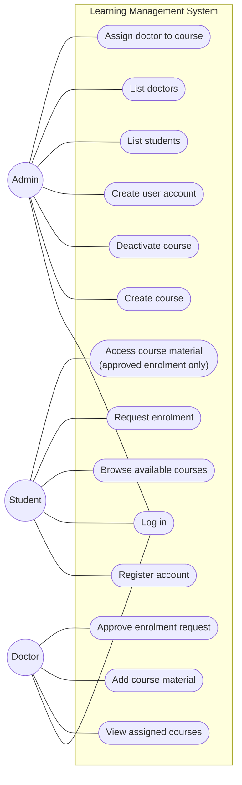
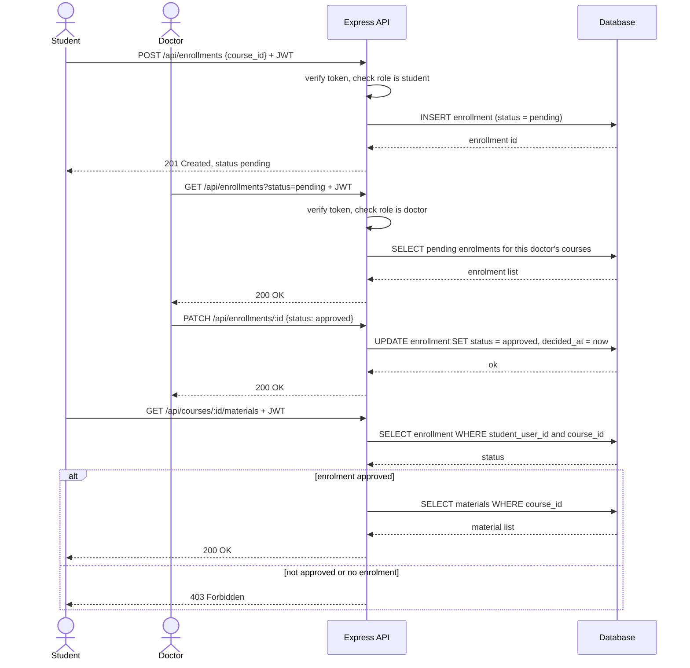
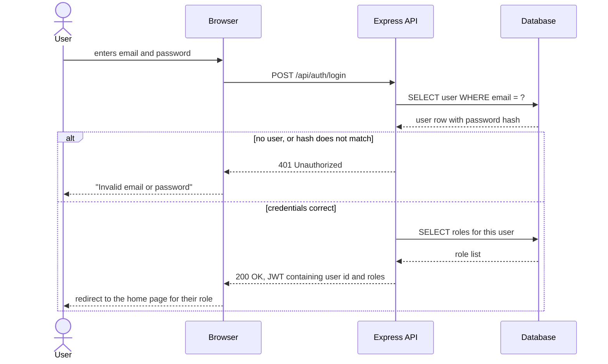
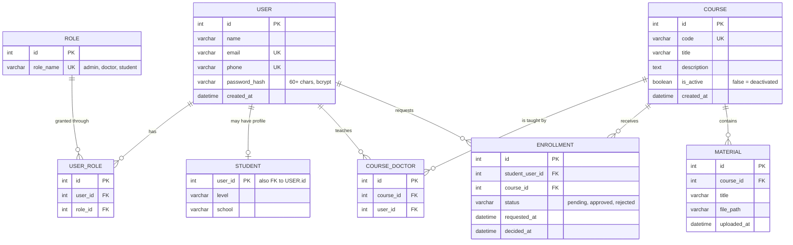

# Learning Management System — Design Diagrams

Diagrams for the Internet and Web Technologies coursework (KH5041CMD).
Paste any block into https://mermaid.live to render and export a PNG for the report.

---

## Figure 1 — Use case diagram

---

## Figure 2 — Sequence diagram: enrolment, approval and material access

Shows both authorisation layers: the role check when a student requests enrolment,
and the approved-enrolment check before any material is returned.

---

## Figure 3 — Sequence diagram: login

The failure branch returns the same message whether the email or the password was
wrong, so an attacker cannot confirm which email addresses are registered.

---

## Figure 4 — Entity relationship diagram

---

## Decisions still open

1. **Who creates accounts.** The diagrams show public registration creating a student,
   with the admin also able to create any role. Change this if you meant admin-only
   account creation.

2. **One doctor per course, or several.** `COURSE_DOCTOR` is a join table, so a course
   can have several doctors. If a course only ever has one, replace the table with a
   single `doctor_id` foreign key on `COURSE`.

3. **Password column.** `varchar(255)`, never `varchar(50)` — a bcrypt hash is 60
   characters and would be silently truncated.

4. **Uniqueness.** On `email` (and `phone` if wanted). Not on password.
